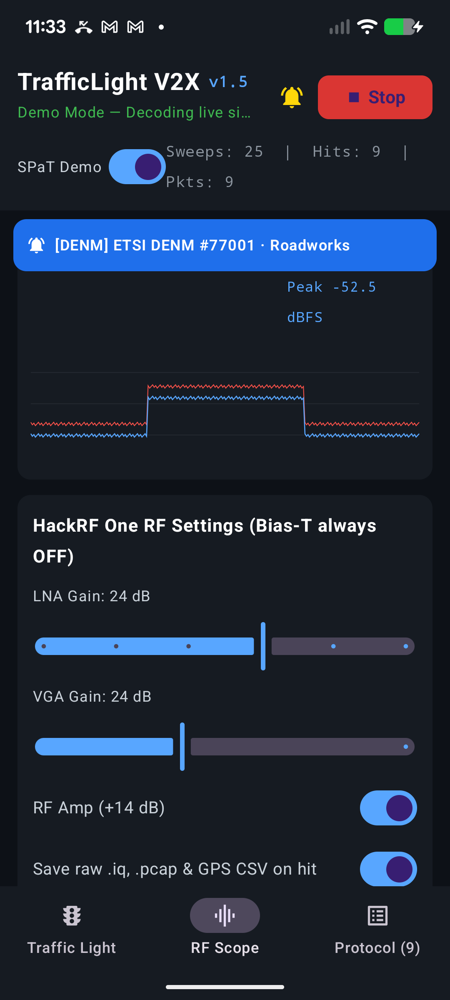

# TrafficLight V2X — Real-Time 5.9 GHz DSRC & C-V2X Scanner / Decoder for Android + HackRF One

**TrafficLight V2X** (`v1.5`) is a native Android application that connects directly to a **HackRF One** over USB-OTG (no root or Termux required) to monitor, capture, alert on, and decode **5.9 GHz Vehicle-to-Infrastructure (V2I), Vehicle-to-Vehicle (V2V), and Vehicle-to-Pedestrian (V2P)** safety broadcasts in real time.

It includes a live **Traffic Signal GUI** that displays the active traffic light phase (Red, Yellow, Green, Protected Left Arrow) and countdown timer from decoded **SAE J2735 SPaT** broadcasts, alongside a live **RF Spectrum Scope**, **Protocol Inspector**, **customizable Signal Alerts**, and **GPS-tagged `.iq` / `.pcap` logging**.

## Screenshots

| Traffic Light GUI & Alert Banner | Live RF Scope & Controls | Protocol Inspector (`SPaT`/`BSM`/`CAM`/`DENM`) | Customizable Signal Alerts |
| :---: | :---: | :---: | :---: |
|  |  |  |  |

---

## What the App Does

- **Traffic Light GUI (Tab 1):** Renders a glowing traffic signal head with live countdown timer (`minEndTime`) and a Signal Group switcher for every lane/approach broadcast by a traffic light Roadside Unit (RSU).
- **Live RF Scope (Tab 2):** Real-time 256-bin FFT spectrum + peak-hold display, noise floor / peak dBFS readouts, LNA / VGA / RF Amp controls, live GPS lock status, and automatic `.iq` / `.pcap` / `hits_gps.csv` recording.
- **Protocol Inspector (Tab 3):** Live scrollable feed of decoded packets (`SPaT`, `MAP`, `BSM`, `TIM`, `SRM`, `SSM`, `RTCM`, `PSM`, `EVA`, `RSA`, `CAM`, `DENM`, `SPATEM`, `MAPEM`, `WSMP`, `802.11`). Tap any packet to expand all decoded fields and its raw hex dump.
- **Customizable Signal Alerts (Bell Icon):**
  - 4 one-tap presets: **Field Drive**, **Lights Only**, **Emergencies**, and **Silent**.
  - 7 grouped protocol toggles (e.g., mute noisy `RTCM` GPS corrections or `802.11` Wi-Fi while alerting on `SPaT`, `C-V2X_BURST`, and `EVA`/`DENM`).
  - Independent toggles for **Sound Chime** (distinct tones by priority), **Vibration**, **On-Screen Alert Banner**, **New Intersection / ID Only**, and **Cooldown (`2s / 5s / 10s / 30s`)**.
- **Built-in SPaT Demo Mode:** Generates genuine bit-packed 802.11p → WSMP → SAE J2735 UPER (`SPaT`, `BSM`) and ETSI GeoNetworking (`CAM`, `DENM`) frames and runs them through the live decoder so you can preview the entire app at your desk.
- **Field-Drive Friendly:** Automatically keeps the screen awake while scanning (`FLAG_KEEP_SCREEN_ON`) and stamps every hit with the phone's GPS coordinates in `hits_gps.csv` (ready to import into Google Maps).

---

## How It Works

```text
5.85–5.925 GHz RF (RSU / Vehicle)
        │
        ▼
  HackRF One (USB-OTG, Bias-T OFF)
        │  libhackrf vendor control transfers + bulk int8 I/Q
        ▼
  Native C++17 ARM64 JNI DSP (libdsrc_dsp.so)
   ├─ 5 ms PLL startup-transient trim + DC offset removal
   ├─ 256-pt Hann FFT (averaged + peak-hold spectrum + wideband burst detector)
   └─ IEEE 802.11p OFDM PHY Decoder:
      Schmidl-Cox sync → LTS CFO & LS equalizer → 64-pt FFT
      → BPSK/QPSK/16-QAM soft demap → 64-state Viterbi → descrambler → CRC-32
        │
        ▼
  Kotlin Protocol Stack (V2xDecoder.kt)
   ├─ US DSRC: 802.11 MAC → LLC/SNAP (0x88DC) → WSMP (IEEE 1609.3)
   │           → IEEE 1609.2 unwrap → SAE J2735 ASN.1 UPER
   └─ EU ITS-G5: 802.11 MAC → LLC/SNAP (0x8947) → GeoNetworking → BTP → ETSI ITS
        │
        ▼
  Jetpack Compose UI + Alerts + Logger (.pcap, .iq, hits_gps.csv)
```

### Important Notes on Protocol Types
- **DSRC / ITS-G5 (IEEE 802.11p, 10 MHz OFDM):** Decoded **live on-device** into human-readable fields and saved to `dsrc_decoded.pcap`.
- **C-V2X (3GPP LTE-V2X PC5 Sidelink, 10/20 MHz SC-FDMA):** Detected in real time on the RF Scope (e.g., `Ch 183 · 5915 MHz @ 20 MS/s`), triggers alerts, logs GPS to `hits_gps.csv`, and saves the full `20 MS/s` raw `.iq` burst for offline PC5 decoding (such as `srsRAN 4G`).
- **V2N (Commercial 4G LTE / 5G NR Cellular):** Encrypted by cellular carriers and cannot be decoded with a passive SDR.

---

## Required Hardware

| Item | Requirement / Notes |
|---|---|
| **SDR** | **HackRF One** (standalone, or HackRF One + PortaPack H2 switched into **HackRF Mode**) |
| **Android Device** | 64-bit (`arm64-v8a`) Android 9+ phone or tablet with **USB-OTG Host** support (tested on **Google Pixel 6**, Android 17) |
| **USB-C OTG Dongle** | USB-C (male) to USB-A (female) OTG adapter, *or* a direct USB-C to Micro-USB OTG data cable |
| **USB-A to Micro-USB Cable** | **Must be a data cable** (charge-only cables power the LEDs but will not enumerate USB!) |
| **USB Battery Pack + Powered OTG Y-Cable *(Optional)*** | Modern USB-C phones (like Pixel 6) can power the HackRF One (~300–400 mA) directly. Older phones or long multi-hour drives benefit from a powered USB-OTG Y-cable connected to a small 5V USB power bank. |
| **5.8 / 5.9 GHz Antenna** | Must cover **`5700 – 5950 MHz`** (SMA male connector for HackRF One). Stock telescoping antennas have poor sensitivity at 5.9 GHz. |

### Frequency Range the Antenna Must Cover
Your antenna should be tuned for **`5700 – 5950 MHz`** (5.7–5.95 GHz) to cover all relevant channels:
- **5725 – 5850 MHz:** 5.8 GHz ISM / 5 GHz Wi-Fi (used for desk sanity-testing via the `Wi-Fi Test · 5745` preset)
- **5850 – 5895 MHz:** Legacy US DSRC channels (`Ch 172` 5860, `Ch 174` 5870, `Ch 176` 5880, `Ch 178` 5890 MHz)
- **5895 – 5925 MHz:** Dedicated US FCC ITS / C-V2X Safety Band (`Ch 180` 5900, `Ch 182` 5910, `Ch 184` 5920 MHz, plus 20 MHz aggregated `Ch 181` 5905 and `Ch 183` 5915 MHz)

### Tested Antenna
- **Maple Leaf 5.8G 5 dBi Directional Rod Antenna (5700–5950 MHz, SMA, Linear Polarization):**
  https://www.amazon.com/dp/B0DYDMRR2Q?ref=ppx_yo2ov_dt_b_fed_asin_title&th=1
- **Field tip:** Roadside RSUs typically use **vertical linear polarization** (up to 33 dBm EIRP toward the horizon). Mount or hold the rod **vertically** with clear line-of-sight through a windshield or window, and always keep **Bias-T / Antenna Power OFF** (the app forces Bias-T OFF automatically to protect passive antennas).

---

## Supported Protocols & Messages

| Standard | Protocol / Message | Description |
|---|---|---|
| **US SAE J2735 (V2I)** | `SPaT` (MsgID 19) | Traffic light phase (Red/Yellow/Green/Arrow) & countdown timer |
| **US SAE J2735 (V2I)** | `MAP` (MsgID 18) | Intersection lane geometry & reference GPS |
| **US SAE J2735 (V2V)** | `BSM` (MsgID 20) | Vehicle temp ID, GPS, speed, heading, steering, brake status |
| **US SAE J2735 (V2I)** | `TIM` (MsgID 31) | Traveler Information (work zones, speed advisories, wrong-way alerts) |
| **US SAE J2735 (V2I)** | `SRM` (29) / `SSM` (30) | Transit & emergency vehicle green-light priority request / status |
| **US SAE J2735 (V2I)** | `RTCM` (MsgID 28) | Differential GPS corrections from RSUs |
| **US SAE J2735 (V2P)** | `PSM` (MsgID 32) | Pedestrian / cyclist Personal Safety Message |
| **US SAE J2735 (V2V/I)** | `EVA` (22) / `RSA` (27) | Emergency Vehicle Alert / Road Side Hazard Alert |
| **EU ETSI ITS-G5** | `CAM` (2) / `DENM` (1) | Cooperative Awareness / Decentralized Hazard Notification |
| **EU ETSI ITS-G5** | `SPATEM` (4) / `MAPEM` (5) | European SPaT / MAP over GeoNetworking (`0x8947`) + BTP |

---

## Quick-Start Guide

### 1. Install the APK
Install `TrafficLightV2X-v1.5.apk` via ADB from a computer:
```bash
adb install -r TrafficLightV2X-v1.5.apk
```
*(Or copy the APK to your Android device and install it directly by allowing "Install unknown apps".)*

Approve the **Location** permission prompt on first launch so detections are tagged with GPS coordinates.

### 2. Verify the UI Immediately (SPaT Demo Mode)
1. Toggle **SPaT Demo** **ON** in the top bar and tap **Start**.
2. Watch the glowing **Traffic Signal Head** cycle through Green → Yellow → Red with a live countdown, and tap the Signal Group chips (`SG 2`, `SG 5`, `SG 6`) to switch approaches.
3. Open the **Protocol** tab and tap any `SPaT`, `BSM`, `CAM`, or `DENM` packet to inspect its unpacked fields and hex dump.
4. Tap the **yellow bell icon** in the top bar to customize your alert presets and test the chime.

### 3. Verify Live HackRF One Connection at Your Desk
1. Toggle **SPaT Demo** **OFF**.
2. Connect the **HackRF One** (with your 5.8 GHz antenna attached) to your Android phone via the **USB-C OTG dongle + Micro-USB data cable**.
3. Select the **`Wi-Fi Test · 5745`** preset, tap **Start**, and approve the Android USB permission popup.
4. Open the **RF Scope** and **Protocol** tabs — nearby 5 GHz Wi-Fi beacons (SSIDs and 802.11 frames) should appear, confirming end-to-end RF reception and decoding.

### 4. Field-Testing Near V2X Intersections
- Switch to **`Scan All DSRC`** (for 10 MHz legacy/dual-mode 802.11p RSUs on `5860–5920 MHz`) or **`Ch 183 · 5915 (20M C-V2X)`** (for post-transition 20 MHz C-V2X corridors).
- Recommended starting RF gains: `LNA = 24 dB`, `VGA = 24 dB`, `RF Amp = ON`.
- **Finding active RSUs:** Look up licensed Roadside Unit coordinates in the **FCC Universal Licensing System (ULS)** under Radio Service Code **`IQ`** (Intelligent Transportation Service) or on the **USDOT Connected Vehicle Deployment Map**.

### 5. Pulling Captured Files Back to Your Computer
Captures are stored in the app's external files directory:
```text
/sdcard/Android/data/com.trafficlight.v2x/files/v2x_captures/
├── dsrc_decoded.pcap        # Open directly in Wireshark (WSMP / ITS / SPATEM dissectors)
├── hits_gps.csv             # Import into Google Maps / My Maps to plot RSU locations
└── burst_YYYYMMDD_HHMMSS_*MHz.iq   # Raw HackRF int8 I/Q bursts for offline analysis
```
Pull them over USB with:
```bash
adb pull /sdcard/Android/data/com.trafficlight.v2x/files/v2x_captures/ ./field_captures/
```

---

## Companion macOS Scripts (Included in This Project)

- **`antenna_check.py`** — Sweeps `5700–5950 MHz` on a Mac-attached HackRF One and generates a text report + PNG power-vs-frequency plot to verify antenna reception.
- **`v2x_monitor.py`** — Continuous macOS 5.9 GHz DSRC/C-V2X scanner with raw `.iq` recording, zoomed waterfall spectrograms, and automatic offline DSRC decoding.
- **`decode_dsrc.py`** — Offline GNU Radio 3.10 (`gr-ieee802-11` + `gr-foo`) + `tshark` decoder for saved HackRF `.iq` files.

---

## Safety & Legal Notice
- **Receive-only:** This application and companion scripts are strictly **passive receivers** and never transmit on any frequency.
- **Drive safely:** Never operate or stare at the app while driving. Use a passenger or rely on the audio alert chimes and review logged `hits_gps.csv` / `.pcap` files after you park.
