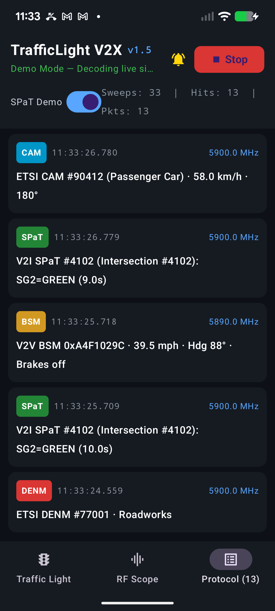
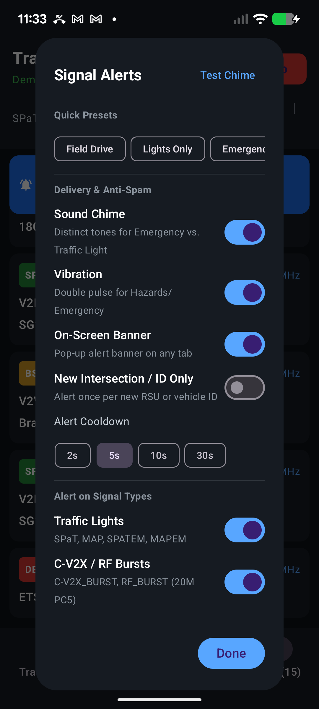
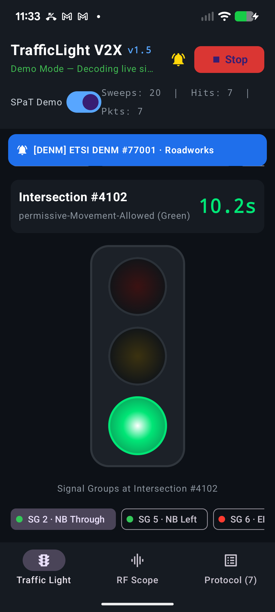

# RoadSense V2X — 5.9 GHz DSRC & C-V2X Scanner / Decoder for Android + HackRF One

**RoadSense V2X** (`v1.6`) is a portable, passive **5.9 GHz DSRC (IEEE 802.11p / ITS-G5) and C-V2X (PC5) RF scanner, recorder, and real-time protocol decoder** for Android + HackRF One (no root or Termux required).

Its primary purpose is to **capture 5.9 GHz Intelligent Transportation System (ITS) broadcasts and turn them into human-readable roadway, vehicle, hazard, and safety intelligence** — including nearby vehicle telemetry, roadwork/wrong-way advisories, emergency vehicle alerts, transit signal priority requests, pedestrian safety messages, and intersection timing. As a fun bonus view, it also includes a live **Traffic Signal Head** UI that visualizes decoded intersection `SPaT` broadcasts as a glowing signal with a countdown timer.

## Screenshots

| Protocol Inspector (Human-Readable V2X) | Live RF Scope & Scanner | Customizable Signal Alerts | Bonus View: Live Traffic Signal GUI |
| :---: | :---: | :---: | :---: |
|  |  |  |  |

---

## What Human-Readable Information It Decodes

- **Vehicle-to-Vehicle (V2V) Safety Telemetry (`SAE BSM`, `ETSI CAM`):** Nearby connected vehicles' temporary/station ID, GPS coordinates, elevation, speed (mph & km/h), heading, steering angle, transmission gear, vehicle dimensions, and **active braking status**.
- **Roadway Hazards & Advisories (`SAE TIM`, `RSA`, `ETSI DENM`):** Work zone warnings, wrong-way driving (WWD) alerts, accidents, stationary vehicles, adverse weather, and dynamic speed advisories broadcast by Roadside Units (RSUs).
- **Emergency & Transit Priority (`SAE EVA`, `SRM`, `SSM`):** Approaching emergency vehicle alerts (police/fire/EMS) and transit/emergency requests for green-light signal priority at intersections.
- **Pedestrian & Cyclist Safety (`SAE PSM`):** Vulnerable road user (V2P) safety broadcasts.
- **Intersection Infrastructure (`SAE SPaT`, `MAP`, `RTCM`, `ETSI SPATEM`, `MAPEM`):** Live signal phases (Red / Yellow / Green / Protected Left Arrow), countdown timers (`minEndTime`), intersection lane geometry, and RSU differential GPS corrections.
- **RF & Location Intelligence:** Live 256-bin FFT spectrum + peak hold, noise floor & peak dBFS, wideband burst detection (for C-V2X PC5 corridors), GPS-tagged `hits_gps.csv` (ready for Google Maps), standard `dsrc_decoded.pcap` (ready for Wireshark), and full raw `.iq` burst recordings.

---

## Core App Features

- **Protocol Inspector:** Scrollable, color-coded live feed of all 14 supported V2X/ITS message types plus general 802.11 frames. Tap any packet to expand all decoded fields, GPS coordinates, and the raw hex dump.
- **Live RF Scope & Channel Scanner:** Real-time spectrum & peak-hold display with presets for `Scan All DSRC` (`5860–5920 MHz`), 20 MHz C-V2X (`Ch 183 · 5915`, `Ch 181 · 5905`), individual 10 MHz ITS channels (`Ch 172–184`), and `Wi-Fi Test · 5745` for desk verification. Includes LNA/VGA/RF Amp controls and live GPS lock readout.
- **Customizable Signal Alerts (Bell Icon):**
  - 4 one-tap presets: **Field Drive**, **Lights Only**, **Emergencies**, and **Silent**.
  - 7 grouped protocol toggles so you can alert on high-value traffic/safety signals while muting noisy utilities (`RTCM` GPS corrections) or general Wi-Fi.
  - Separate controls for **Sound Chime** (distinct tones by priority), **Vibration** (double-pulse for Emergency/Hazards), **On-Screen Alert Banner**, **New Intersection / ID Only** deduplication, and **Cooldown (`2s / 5s / 10s / 30s`)**.
- **Bonus Traffic Signal GUI:** A fun visual companion screen that renders live decoded `SPaT` phase & countdown data as a glowing traffic signal with a Signal Group switcher for different intersection approaches.
- **Built-in Demo Simulator (`SPaT Demo`):** Generates genuine bit-packed 802.11p → WSMP → SAE J2735 UPER (`SPaT`, `BSM`) and ETSI GeoNetworking (`CAM`, `DENM`) frames and runs them through the live decoder so you can test every screen and alert right at your desk.
- **Field-Drive Ready:** Automatically keeps the screen awake (`FLAG_KEEP_SCREEN_ON`) while scanning and logs every detection with GPS coordinates to `hits_gps.csv`.

---

## How It Works

```text
5.85–5.925 GHz RF (RSU / Vehicle / Pedestrian)
        │
        ▼
  HackRF One (USB-OTG, Bias-T forced OFF)
        │  libhackrf vendor control transfers + bulk int8 I/Q
        ▼
  Native C++17 ARM64 JNI DSP (libdsrc_dsp.so)
   ├─ 5 ms PLL startup-transient trim + DC offset removal
   ├─ 256-pt Hann FFT (averaged + peak-hold spectrum + wideband burst detector)
   └─ IEEE 802.11p OFDM PHY Decoder:
      Schmidl-Cox sync → LTS CFO & LS equalizer → 64-pt FFT
      → BPSK/QPSK/16-QAM soft demap → 64-state Viterbi → descrambler → CRC-32
        │
        ▼
  Kotlin Protocol Stack (V2xDecoder.kt)
   ├─ US DSRC: 802.11 MAC → LLC/SNAP (0x88DC) → WSMP (IEEE 1609.3)
   │           → IEEE 1609.2 unwrap → SAE J2735 ASN.1 UPER
   └─ EU ITS-G5: 802.11 MAC → LLC/SNAP (0x8947) → GeoNetworking → BTP → ETSI ITS
        │
        ▼
  Jetpack Compose UI + Priority Alerts + Logger (.pcap, .iq, hits_gps.csv)
```

### Protocol Capabilities (DSRC vs. C-V2X vs. V2N)
- **DSRC / ITS-G5 (IEEE 802.11p, 10 MHz OFDM):** Decoded **live on-device** into human-readable fields and saved to `dsrc_decoded.pcap`.
- **C-V2X (3GPP LTE-V2X PC5 Sidelink, 10/20 MHz SC-FDMA):** Detected in real time on the RF Scope (e.g., `Ch 183 · 5915 MHz @ 20 MS/s`), triggers alerts, logs GPS to `hits_gps.csv`, and saves the full `20 MS/s` raw `.iq` burst for offline PC5 decoding (e.g., `srsRAN 4G`).
- **V2N (Commercial 4G LTE / 5G NR Cellular):** Encrypted by cellular carriers and cannot be decoded with a passive SDR.

---

## Required Hardware

| Item | Requirement / Notes |
|---|---|
| **SDR** | **HackRF One** (standalone, or HackRF One + PortaPack H2 switched into **HackRF Mode**) |
| **Android Device** | 64-bit (`arm64-v8a`) Android 9+ phone or tablet with **USB-OTG Host** support (tested on **Google Pixel 6**, Android 17) |
| **USB-C OTG Dongle** | USB-C (male) to USB-A (female) OTG adapter, *or* a direct USB-C to Micro-USB OTG data cable |
| **USB-A to Micro-USB Cable** | **Must be a data cable** (charge-only cables power the LEDs but will not enumerate USB) |
| **USB Battery Pack + Powered OTG Y-Cable *(Optional)*** | Modern USB-C phones (like Pixel 6) can power the HackRF One (~300–400 mA) directly. Older phones or long multi-hour drives benefit from a powered USB-OTG Y-cable connected to a small 5V USB power bank. |
| **5.8 / 5.9 GHz Antenna** | Must cover **`5700 – 5950 MHz`** (SMA male connector for HackRF One). Stock telescoping antennas have poor sensitivity at 5.9 GHz. |

### Required Antenna Frequency Coverage (`5700 – 5950 MHz`)
- **5725 – 5850 MHz:** 5.8 GHz ISM / 5 GHz Wi-Fi (used for desk sanity-testing via the `Wi-Fi Test · 5745` preset)
- **5850 – 5895 MHz:** Legacy US DSRC channels (`Ch 172` 5860, `Ch 174` 5870, `Ch 176` 5880, `Ch 178` 5890 MHz)
- **5895 – 5925 MHz:** Dedicated US FCC ITS / C-V2X Safety Band (`Ch 180` 5900, `Ch 182` 5910, `Ch 184` 5920 MHz, plus 20 MHz aggregated `Ch 181` 5905 and `Ch 183` 5915 MHz)

### Tested Antenna
- **Maple Leaf 5.8G 5 dBi Directional Rod Antenna (5700–5950 MHz, SMA, Linear Polarization):**
  https://www.amazon.com/dp/B0DYDMRR2Q?ref=ppx_yo2ov_dt_b_fed_asin_title&th=1
- **Field tip:** Roadside RSUs typically use **vertical linear polarization** (up to 33 dBm EIRP toward the horizon). Keep the rod **vertical** with clear line-of-sight through a windshield or window, and always keep **Bias-T / Antenna Power OFF** (enforced automatically by the app to protect passive antennas).

---

## Supported Protocols & Messages

| Standard | Protocol / Message | Description |
|---|---|---|
| **US SAE J2735 (V2V)** | `BSM` (MsgID 20) | Vehicle temp ID, GPS, speed, heading, steering, gear, brake status |
| **US SAE J2735 (V2I)** | `SPaT` (MsgID 19) | Traffic light phase (Red/Yellow/Green/Arrow) & countdown timer |
| **US SAE J2735 (V2I)** | `MAP` (MsgID 18) | Intersection lane geometry & reference GPS |
| **US SAE J2735 (V2I)** | `TIM` (MsgID 31) | Traveler Information (work zones, speed advisories, wrong-way alerts) |
| **US SAE J2735 (V2I)** | `SRM` (29) / `SSM` (30) | Transit & emergency vehicle green-light priority request / status |
| **US SAE J2735 (V2I)** | `RTCM` (MsgID 28) | Differential GPS corrections from RSUs |
| **US SAE J2735 (V2P)** | `PSM` (MsgID 32) | Pedestrian / cyclist Personal Safety Message |
| **US SAE J2735 (V2V/I)** | `EVA` (22) / `RSA` (27) | Emergency Vehicle Alert / Road Side Hazard Alert |
| **EU ETSI ITS-G5** | `CAM` (2) / `DENM` (1) | Cooperative Awareness / Decentralized Hazard Notification |
| **EU ETSI ITS-G5** | `SPATEM` (4) / `MAPEM` (5) | European SPaT / MAP over GeoNetworking (`0x8947`) + BTP |

---

## Quick-Start Guide

### 1. Download & Install the APK
Download **`RoadSenseV2X-v1.6.apk`** from the [Releases page](https://github.com/drinkingc0ffee/RoadSense-V2X/releases/tag/v1.6) and install via ADB:
```bash
adb install -r RoadSenseV2X-v1.6.apk
```
*(Or copy the APK directly to your Android phone and install it by allowing "Install unknown apps".)*

Approve the **Location** permission prompt on first launch so detections are stamped with GPS coordinates.

### 2. Test the Decoder & Alerts at Your Desk (`SPaT Demo`)
1. Toggle **SPaT Demo** **ON** in the top bar and tap **Start**.
2. Open the **Protocol** tab and tap any `BSM`, `CAM`, `DENM`, or `SPaT` packet to inspect its unpacked fields and hex dump.
3. Tap the **yellow bell icon** in the top bar to try the alert presets and **Test Chime**.
4. Switch to the **Traffic Light** tab to see the bonus glowing signal head and live countdown.

### 3. Verify Live HackRF One Reception (`Wi-Fi Test · 5745`)
1. Toggle **SPaT Demo** **OFF** and connect the **HackRF One** (with your 5.8 GHz antenna attached) to your Android phone via the **USB-C OTG dongle + Micro-USB data cable**.
2. Select **`Wi-Fi Test · 5745`**, tap **Start**, and approve the Android USB permission popup.
3. Open **RF Scope** and **Protocol** — nearby 5 GHz Wi-Fi beacons (SSIDs and 802.11 frames) should decode live, confirming end-to-end RF hardware and DSP operation.

### 4. Field-Scanning V2X Corridors
- Select **`Scan All DSRC`** (10 MHz legacy/dual-mode 802.11p RSUs across `5860–5920 MHz`) or **`Ch 183 · 5915 (20M C-V2X)`** (post-transition 20 MHz C-V2X corridors).
- Recommended starting gains: `LNA = 24 dB`, `VGA = 24 dB`, `RF Amp = ON`.
- **Finding active RSUs:** Look up licensed RSU coordinates in the **FCC Universal Licensing System (ULS)** under Radio Service Code **`IQ`** (Intelligent Transportation Service) or on the **USDOT Connected Vehicle Deployment Map**.

### 5. Exporting Captures to Wireshark & Google Maps
Captures are stored on the phone at:
```text
/sdcard/Android/data/com.trafficlight.v2x/files/v2x_captures/
├── dsrc_decoded.pcap               # Open directly in Wireshark (WSMP / ITS / SPATEM dissectors)
├── hits_gps.csv                    # Import into Google Maps / My Maps to plot RSU locations
└── burst_YYYYMMDD_HHMMSS_*MHz.iq   # Raw HackRF int8 I/Q bursts for offline analysis
```
Pull them over USB with:
```bash
adb pull /sdcard/Android/data/com.trafficlight.v2x/files/v2x_captures/ ./field_captures/
```

---

## Companion macOS Scripts (Included in This Repository)

- **`antenna_check.py`** — Sweeps `5700–5950 MHz` on a Mac-attached HackRF One and generates a text report + PNG power-vs-frequency plot to verify antenna reception.
- **`v2x_monitor.py`** — Continuous macOS 5.9 GHz DSRC/C-V2X scanner with raw `.iq` recording, zoomed waterfall spectrograms, and automatic offline DSRC decoding.
- **`decode_dsrc.py`** — Offline GNU Radio 3.10 (`gr-ieee802-11` + `gr-foo`) + `tshark` decoder for saved HackRF `.iq` files.

---

## Safety & Legal Notice
- **Passive receive-only:** This application and companion scripts never transmit on any frequency.
- **Drive safely:** Never operate or stare at the app while driving. Use a passenger or rely on the audio alert chimes and review logged `hits_gps.csv` / `.pcap` files after you park.
